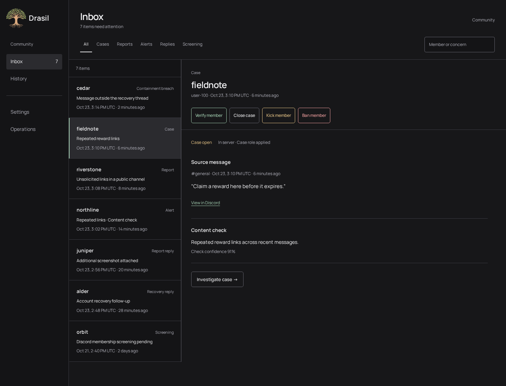

# Complete moderation workflow studies

A design pass across all six remaining workflow areas, using the approved flat grey inbox and case detail composition. These are screenshots of the actual React studies, with fixture data and simulated actions. Production integration has not started.

Start with the [mixed inbox](inbox.png), then compare the workflows below.

| Area                            | Main preview                                  | Related states                                                                                                                   |
| ------------------------------- | --------------------------------------------- | -------------------------------------------------------------------------------------------------------------------------------- |
| Mixed inbox                     | [Inbox](inbox.png)                            | [Submitted report](report.png), [reporter follow-up](reporter.png), [screening](screening.png), [containment breach](breach.png) |
| Account quarantine and recovery | [Role and permission preview](quarantine.png) | [Incomplete containment](incomplete.png), [recovery review](recovery.png)                                                        |
| Browser security checks         | [Pending check](security.png)                 | [Passed check, case still open](passed.png)                                                                                      |
| Message cleanup                 | [Frozen candidate preview](preview.png)       | [Individual outcomes](cleanupResults.png), [retry case updates after ban](finalization.png)                                      |
| Channel conversation            | [Source in context](conversation.png)         | [Narrow screen](conversation-narrow.png)                                                                                         |
| Action results                  | [Unknown ban outcome](unknown.png)            | [Ban confirmed, report updates pending](updates.png)                                                                             |

Narrow-screen examples: [inbox](inbox-narrow.png), [containment preview](quarantine-narrow.png), [cleanup](preview-narrow.png), [unknown ban outcome](unknown-narrow.png).

For the interactive studies, run `npm --workspace apps/web run storybook` and open **Design foundation → Complete moderation workflows**. Select a named story or use the view control. The stories include the additional pending, expired, bypassed, failed, blocked and resolved states. Actions open contextual confirmations and simulate queued receipts locally; state selection in Storybook shows the resulting workflow stages. Links retain their intended application/Discord destinations.

Read the [workflow decisions and data requirements](../../moderation-workflow-coverage.md) alongside the [overall workspace design](../../../superpowers/specs/2026-10-23-moderation-workspace-design.md).

The fixed screenshot clock is October 23, 2026, 15:16 UTC. Independent workflow audits and UX review informed this pass. The user approved these designs on October 24, 2026. The [implementation plan](../../../superpowers/plans/2026-10-24-moderation-workspace.md) connects the approved components and workflows to real data and actions.

