# Pre-emptive ban by ID implementation plan

Enable an authorized moderator to run `/ban user-id:<Discord ID>` before the user joins. Keep `/ban user:<user>` working. Exactly one target input is required. This choice is delegated by BASIC; no product decision remains open.

## Approach and scope

Extend the existing command because it already routes through shared `ban_user`, policy, confirmation and Discord orchestration. A separate command would duplicate the same workflow. `ban_case_user_by_id` remains case-bound and is unsuitable for a user without a case.

```mermaid
flowchart TD
  A[Moderator runs /ban] --> B[Choose user or paste user-id]
  B --> C{One valid target?}
  C -->|No| D[Correct input]
  C -->|Yes| E[Review username and exact ID]
  E -->|Cancel| F[No action]
  E -->|Confirm| G[Fresh authorization and policy checks]
  G --> H{Current member?}
  H -->|Yes| I[Existing member ban]
  H -->|Unknown Member| J[Existing by-ID ban]
  H -->|Lookup failed| K[Stop with error]
  I --> L[Ban receipt and audit]
  J --> L
```

No membership, join, case, role or thread will be created for a never-member. Existing cases still resolve normally. Audit outcomes retain the target, moderator and reason. The current MCP uncertain-send lifecycle and retry fences remain in place. No schema, dependency, bulk moderation or dashboard changes are planned.

## Work and verification

- [ ] Add failing command tests for raw IDs, invalid/ambiguous input and exact confirmation identity.
- [ ] Update `commandDefinitions.ts`, `ModerationCommandHandler.ts`, README and moderation-permissions help. Keep IDs as strings and validate without Number conversion.
- [ ] Add service tests for never-members, existing membership, protected targets, nonexistent users, existing bans and provider failures. Use `markBannedIfNotNewer` for existing membership only.
- [ ] Tighten `adapters/cases.ts` to distinguish Unknown Member from lookup failures. Keep shared action and MCP contracts unchanged.
- [ ] Run focused unit, build, lint, format and boundary checks. Use hosted CI for complete database/browser coverage. Inspect exact-head native-enforcement integration results.
- [ ] Publish the issue-linked PR and iterate feedback. After the last pushed commit is at least 30 minutes old, refresh all checks, comments, review threads, reviews and mutable summaries twice before claiming readiness.

## Release and acceptance boundary

Merge and deployment require separate approval. Production deploys automatically from main. Live acceptance requires an approved disposable target and explicit ban/unban authorization. Local/CI evidence cannot establish live Discord acceptance.

## Evidence

Issue: https://github.com/BITRATE-Labs/drasil/issues/297

Base: `283b7bb6828317d8fd7ad008a34cb24f73f65f46`. Worktree: `D:/bench/drasil-wt/preemptive-ban-by-id`. Branch: `codex/preemptive-ban-by-id`.
