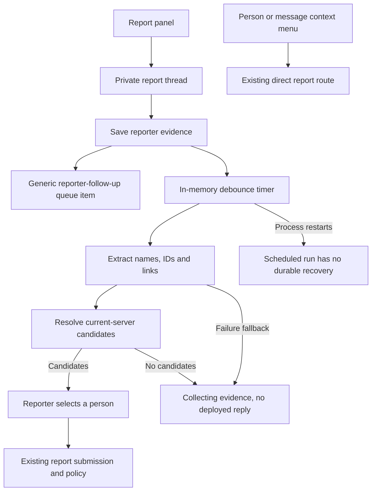

# Report intake investigation

## What this investigation establishes

The report assistant needs a complete identity-resolution and admin-handoff design. The current pipeline can extract evidence successfully, fail to find a person, and leave the reporter waiting. A local patch improves the search and adds a no-match reply, but does not establish full coverage of account display names or a reliable admin handoff.

The user has confirmed that unresolved identification should direct an admin to the situation without requiring another action from the reporter. The user also requires consideration of the person's name displayed within the server, even when it differs from their account name.

This is an investigation record, not an approved design or implementation plan. The user subsequently selected the staged assistant; the full design is awaiting document approval. Existing local implementation commits remain provisional and are not deployed.

## Name semantics

| Concept                       | Authoritative field                                    | Meaning and limitation                                                                                                                         |
| ----------------------------- | ------------------------------------------------------ | ---------------------------------------------------------------------------------------------------------------------------------------------- |
| Discord account identifier    | User `id`                                              | Stable account key. A visible or model-extracted ID still needs validation against Discord.                                                    |
| Username                      | User `username`                                        | Account handle. Treat the ID, rather than the text name, as identity.                                                                          |
| Account display name          | User `global_name`, discord.js `User.globalName`       | Optional, non-unique display text. It may differ from the username and server nickname.                                                        |
| Server nickname               | Guild member `nick`, discord.js `GuildMember.nickname` | Optional name for that person in this server.                                                                                                  |
| Effective server display name | discord.js `GuildMember.displayName`                   | `nickname ?? user.displayName`; `User.displayName` is `globalName ?? username`. This is computed, not a fourth independent Discord name field. |
| Server's own name             | Guild `name`                                           | Context about a community, not a person's name. Do not route it into person matching merely because it is visible in a screenshot.             |

Sources: [Discord user fields](https://docs.discord.com/developers/resources/user#user-object), [guild member fields](https://docs.discord.com/developers/resources/guild#guild-member-object), and the installed discord.js getters in `node_modules/discord.js/src/structures/GuildMember.js` and `User.js`.

## Incident evidence and limits

The previously authorized trace inspection showed one extraction run of about three seconds. It returned a display name and a username, no user ID or message link, and also included the server's own title among visible names. Candidate resolution returned zero candidates; persistence completed; no confirmation was sent. The intake remains in `collecting_evidence`, and the thread contains only its welcome and the reporter's screenshot.

A successful extraction response does not prove that the visible username was read accurately. The particular account's identity and membership have not been independently established. Do not describe the incident as proven account departure or proven lookup-only failure.

The current connected Drasil tools can read the intake and its messages but require a user ID for member context. The original reporter no longer has that ID. Browser access is disabled in the current desktop settings. Native Discord observation was unreliable, and local AWS CLI credentials are unavailable. No credentials were copied, no extra access was enabled, and no moderation action was performed.

## Current flow

The generic attention item is not a dedicated identity-resolution handoff. It is created for reporter evidence, is labeled as a follow-up, and does not explain whether resolution failed, was incomplete, or found conflicting identities.

## Findings

| Finding                                                                                            | Evidence                                                                                                                                                                                                                                                     | Status                                                                                              |
| -------------------------------------------------------------------------------------------------- | ------------------------------------------------------------------------------------------------------------------------------------------------------------------------------------------------------------------------------------------------------------ | --------------------------------------------------------------------------------------------------- |
| Search discards exact matches beyond its first five prefix results                                 | A regression test returns five longer prefix names followed by the exact account. The deployed algorithm returns none.                                                                                                                                       | Reproduced locally; fixed only in the provisional branch.                                           |
| Deployed search uses a Gateway username-prefix request for a resolver that also compares nicknames | The installed SDK maps `members.fetch({query})` to Gateway opcode 8. The documented REST member search explicitly supports usernames and nicknames.                                                                                                          | Contract mismatch; provisional branch uses REST search. No live A/B result for the original person. |
| Comparing global display names does not make them discoverable                                     | Resolver only examines members returned by remote prefix search. Discord REST search promises username and nickname matching, not global display names. A synthetic cached member with the matching display name is still not consulted.                     | Confirmed code gap.                                                                                 |
| Person names and unrelated screenshot labels share a list                                          | Extraction schema has `visible_names` and `visible_usernames` but no association between a clue, its subject, and its source region. Original trace included a server title.                                                                                 | Observed and confirmed in schema.                                                                   |
| Images always use low detail                                                                       | `createReportIntakeExtractionUserContent` sets `detail: 'low'`. Small text is relevant to identity resolution.                                                                                                                                               | Confirmed configuration; impact on this incident remains unproved.                                  |
| Later evidence can be saved without being analyzed                                                 | Agent joins reporter text then takes the first 2,000 characters; the provider prompt further limits it. Image selection takes the first configured number of images. Completion records total evidence count, including items excluded from the model input. | Confirmed code path.                                                                                |
| Correction does not guarantee immediate reanalysis                                                 | Analysis accepts only `collecting_evidence`. New evidence while waiting for confirmation does not run extraction; rejection changes state and requests more reporter input rather than scheduling a new investigation itself.                                | Confirmed state and handler behavior.                                                               |
| Failure and absence become indistinguishable                                                       | Member-search exceptions become empty results; provider failure becomes a fallback with no identity clues.                                                                                                                                                   | Confirmed code path.                                                                                |
| Debounce work is not durable                                                                       | Scheduled callbacks exist only in an in-memory map; no persisted pending analysis job or startup recovery appears in this service.                                                                                                                           | Confirmed service scope; existing job infrastructure should be assessed for reuse.                  |
| Generic attention can fail without a durable delivery result exposed here                          | Queue creation exits if no queue channel is available. The report service catches and logs attention errors; its public method returns no delivery receipt.                                                                                                  | Confirmed code path.                                                                                |
| Existing selection controls already have useful safeguards                                         | Current-prompt checks, conditional target writes, rejection tracking, disabled-until-persisted buttons, and control retirement exist.                                                                                                                        | Preserve these contracts in the design.                                                             |

Primary API references: [Gateway member requests](https://docs.discord.com/developers/events/gateway-events#request-guild-members), [REST member search](https://docs.discord.com/developers/resources/guild#search-guild-members), [image detail guidance](https://developers.openai.com/api/docs/guides/images-vision).

## Required design coverage

- Resolve account handles, global display names, server nicknames, and effective server display names, with explicit coverage and freshness limits.
- Preserve the source and subject of every extracted clue. Community names, reporter names, mutual-friend labels, and quoted third parties must not silently become target identities.
- Separate text-reading confidence, candidate-match evidence, current membership, and abuse assessment. A high extraction confidence is not a verified account or a reason to enforce moderation.
- Make a bounded attempt to resolve identity. If that attempt is inconclusive, fails, or exhausts coverage, direct an admin to the saved situation automatically. Do not require another reporter action.
- Give admins the source evidence, candidate alternatives, match reasons, unresolved questions, freshness/coverage status, and a direct route to the intake.
- Keep handoff persistence, notification delivery, acknowledgement, and resolution separate. Do not claim notification before delivery is established.
- Handle new evidence, message edits, rejections, stale buttons, process restarts, duplicate work, and partial delivery explicitly.
- Reuse existing report, moderation queue, authorization, and action boundaries. Identification work must not itself grant roles, open restrictive cases, kick, or ban.
- Validate through synthetic adversarial cases and a controlled live run. Preserve the original incident's remaining uncertainty.

## UX references

Read-only Mobbin search on November 3, 2026: `reporting a user with supporting evidence`, web platform, two results. Native search succeeded. Account identity was not exposed by that tool. No matching integration-routing entry was found.

| Reference                                                                                       | Inspected positions            | Relevant observation                                                                                          | Limit                                                                                                            |
| ----------------------------------------------------------------------------------------------- | ------------------------------ | ------------------------------------------------------------------------------------------------------------- | ---------------------------------------------------------------------------------------------------------------- |
| [GoFundMe: reporting an account](https://mobbin.com/flows/fe885fdf-835f-4f8a-ab4c-fced0f200cae) | Preview positions 1, 3, 4 of 4 | Contextual entry, explicit submit action, and a receipt that hands the report to support.                     | Position 2 not inspected. The account is already selected, so this does not establish unknown-identity handling. |
| [Hashnode: reporting an author](https://mobbin.com/flows/04883817-62f1-445c-a400-5bdf3d175532)  | Preview positions 1, 4, 6 of 6 | Target URL is retained in the report form; the completion state says the team received the report for review. | Positions 2, 3, and 5 not inspected. No failed identity lookup is shown.                                         |

These sampled references support retaining evidence and providing a truthful review receipt. They do not establish a suitable identity resolver or prove notification reliability.

## Evidence appendix

- Inspected baseline: `46b2b053060e19b35beccf23f7cf6756490cbe5f`.
- Provisional local commits: `1a3791b` (no-match notice) and `e670d05` (member search). The notice conflicts with the newly confirmed admin-handoff requirement and should not be shipped as the final recovery design.
- Local regression evidence from the preceding investigation: 87 focused tests passed; lint and build passed. This is not full-system or live Discord acceptance.
- Additional read-only synthetic probe: an available cached member was ignored when remote search returned no entries, for both account display name and server display-name queries. This proves the cache is not consulted; it does not prove Discord would return no entries for every server nickname.
- Owning files: `src/services/ReportIntakeAgentService.ts`, `ReportCandidateService.ts`, `ReportIntakeService.ts`, `ReportSubmissionService.ts`, `ModerationQueueService.ts`, `src/controllers/ReportInteractionHandler.ts`, `EventHandler.ts`, `src/utils/reportAiSettings.ts`, `src/services/GPTService.ts`, and `docs/superpowers/specs/2026-10-12-report-copy-design.md`.
