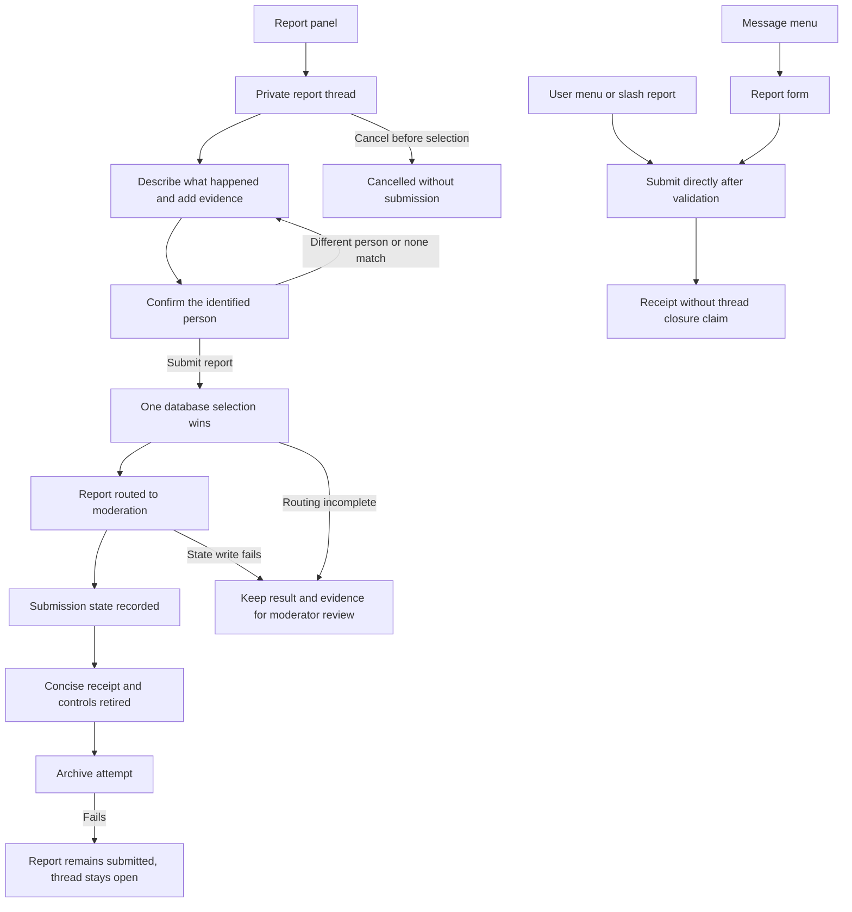

# Clear reporting copy and truthful outcomes

Draft for review. The reporter-facing wording is approved; the behavior and delivery scope below are proposed. Source baseline: `97bf5a51624994cff016b1cb55b7b7908da5ba3e`, current `main` checked on October 12, 2026. No implementation or live Discord changes are included.

## Goal and recommended scope

Reporters should recognize the person they are reporting, understand what each button does, and receive an accurate submission result. Moderators should retain the identities, evidence, provenance, and diagnostics needed to review the report.

Recommend one reporting PR covering the Discord report panel, private thread, confirmation, rejection, submission, cancellation, moderator report-start notification, and report closeouts. Include the stale-button and outcome-handling fixes needed to make the copy true. Audit the other messages now, then handle verification and general web copy in separate changes.

A string-only patch is smaller but leaves misleading results and usable-looking old buttons. A product-wide rewrite would mix reporting behavior with independent verification, web, and operations work. The focused reporting change completes one journey while keeping review manageable.

## Copy contract

Use the action and its result. Say "report", "person", "thread", or "moderator" where those are the intended meanings. Internal names such as `ReportIntakeStatus` remain unchanged. Keep instructions next to the action they explain and omit paragraphs that restate button labels. Do not add decorative success icons or generic community-safety footers.

Do not promise notification, access restoration, archive completion, or an absence of persisted evidence unless the relevant operation establishes it. A queued action is still queued, a partial outcome is still partial, and a report does not automatically mean a case was opened.

Keep model provenance in moderator diagnostics. Admin-facing "AI Assessment" labels deliberately distinguish generated prose, as shipped in PR #223. They are not reporter-facing copy to remove. Preserve destructive-action warnings, restricted-access explanations, and identifiers needed to distinguish people.

## Reporting experience

| Step                                                   | Proposed wording and presentation                                                                                                                                                                                                 |
| ------------------------------------------------------ | --------------------------------------------------------------------------------------------------------------------------------------------------------------------------------------------------------------------------------- |
| Panel                                                  | **Report a user**. "Report a rule violation or suspicious activity. Open a private thread to explain what happened and add evidence." Put message-menu and person-menu alternatives on separate lines. Remove the safety footer.  |
| Welcome                                                | "Describe what happened and who you want to report. Add a message link, screenshot, @mention, username, or user ID." Then "You'll be asked to confirm the person before the report is submitted. To cancel, choose Close Report." |
| One match                                              | "Report this person?" Show readable display name, Discord username, and user ID. Buttons: **Submit report**, **Different person**. No numbering or second instruction paragraph.                                                  |
| Multiple matches                                       | "Who do you want to report?" Number the identity rows. Buttons: **Report 1**, **Report 2**, and so on, plus **None of these**. Numbered buttons stay distinct for duplicate and long names.                                       |
| More than five eligible matches                        | "Showing 5 of <count> matches. If the person isn't listed, add their username, user ID, or a message link." Exclude the reporter before counting.                                                                                 |
| Wrong person                                           | Thread: "No report submitted. Add a username, user ID, message link, or another screenshot." Ephemeral acknowledgement: "Selection cleared."                                                                                      |
| Submitted                                              | "Report submitted for <readable username>." An optional second line, "Moderators have been notified.", is allowed only with confirmed notification evidence. Ephemeral acknowledgement: "Report submitted."                       |
| Cancel before any selection or submission              | "Report cancelled. No report was submitted."                                                                                                                                                                                      |
| Close after selection but without confirmed submission | "The selected person remains recorded for moderator review." Do not call this cancellation or claim nothing was saved.                                                                                                            |
| Reviewed                                               | "Moderators have reviewed this report." For dismissal: "Moderators reviewed this report and closed it without further action."                                                                                                    |
| Reopened                                               | "Report reopened for moderator review."                                                                                                                                                                                           |
| Submitted-button repeat                                | "This report has already been submitted."                                                                                                                                                                                         |
| Closed-button repeat                                   | "This report is closed."                                                                                                                                                                                                          |
| Selection already reserved, submission not confirmed   | "A person has already been selected for this report. No second report was submitted." Do not call the first report submitted.                                                                                                     |
| Superseded question                                    | "Use the latest confirmation message in this thread."                                                                                                                                                                             |
| Failure with uncertain or incomplete submission        | "Drasil couldn't finish submitting this report. Please ask a moderator to review this thread." Preserve saved evidence and do not invite automatic retries.                                                                       |
| Missing report / permission                            | "This report could not be found." / "Only the reporter or a moderator can <specific action>."                                                                                                                                     |

Numbered buttons avoid truncation and duplicate-name ambiguity; identity rows keep readable names. In receipts, <readable username> means the platform-resolved Discord username, not the display name. Use `formatInlineIdentifier` for displayed identity strings and suppress mentions. Do not reduce the shared `formatDiscordUserIdentity` output used by moderators. If a username is unavailable, show the user ID; do not invent a username or rely solely on a mention that can render as `@unknown-user`.

Keep the existing thread-name prefix `Report intake:`. `EventHandler` uses it to avoid automatic detection in report threads if intake handling fails. Do not rename persisted custom IDs, command names, config keys, or enum values during this copy pass. Existing report confirmation/rejection custom IDs must continue to work.

## Behavior design

### Confirmation and prompt retirement

The database, not the buttons, decides whether a selection is allowed. Resolve the intake and validate the clicking user, guild, report thread, and bot-authored confirmation message before looking up the target member. A submitted report must still return its submitted outcome after the reported person leaves the server. Keep the existing conditional `confirmTargetIfUnset` reservation. Add snapshot matching so a selection cannot overwrite newer prompt metadata. Add one report-repository `updateIfCurrent(intake, data)` operation that compares the stored status, selected target, and JSON metadata with the fetched intake snapshot. Use it for the pending and post-selection writes described here. Make rejection conditional on pending, unconfirmed state and an unchanged snapshot. If confirmation wins, rejection must not reset the row to collecting evidence or return "No report submitted".

Apply that pending-state guard to evidence-analysis and prompt-publication writes as well. Slow analysis must not reopen an intake after confirmation, cancellation, or submission. Evidence can remain recorded when a later presentation update loses the race.

Store the IDs of newly sent confirmation messages in existing intake JSON metadata: `confirmation_prompt_message_ids` and `last_confirmation_prompt_message_id`. Compare the clicked message ID with the current stored ID where available. Send new prompts with their controls disabled. Persist the prompt identity conditionally, then enable the controls. Retire older tracked prompts only after the replacement is saved and enabled. If persistence fails or loses its conditional write, leave the new controls disabled and remove them best effort. If enabling fails, retain the saved evidence and intake for moderator review, do not claim confirmation is ready, and do not archive the thread. This prevents an unpublished new message from being mistaken for a legacy prompt.

Retire tracked confirmation controls after confirmation, rejection, cancellation, and moderator closeout. Clearing components must preserve message text and attachments, validate the bot author and matching report custom IDs, and restrict edits to that intake's server and thread. Use the existing `ThreadManager` Discord client and message-fetch patterns, not a new cleanup subsystem. Component failures are best effort and cannot undo a persisted result.

Older prompts have no stored message IDs. Do not scan or rewrite historical threads. Preserve their existing custom IDs and backend authorization. Retire the clicked legacy message after an authorized outcome or an authorized stale click. Other untracked legacy buttons may remain visible until clicked, but cannot create a second report or reverse its state.

### Submission and later Discord failures

Track three milestones in the existing controller: selection accepted, submission service returned `submitted`, and intake state recorded. Change `markSubmitted` to return a boolean that proves the state write; a missing row or exhausted conditional-write collision returns false. A fulfilled void promise is not persistence evidence. Put receipt edits, thread messages, control cleanup, and archive attempts after those milestones. Their failures must not be handled as a failed submission.

If routing returned `submitted` but `markSubmitted` fails, acknowledge the successful service outcome and retain the thread for moderator review rather than treating it as safe to retry. Keep the existing selected-person reservation and detection reuse by intake ID. If service routing throws, do not claim nothing was saved: `SecurityActionService` can create the detection event before notification or routing fails.

The current submission result does not expose whether every route delivered a moderator notification. Default to the unconditional approved first sentence, "Report submitted for <readable username>." Do not add a route-wide notification flag merely for a second sentence. Include the approved notification line only where an existing returned notification message proves delivery; otherwise omit it.

Archive after the receipt and never claim the thread is closed in that receipt. Record and preserve archive failures without replacing submission success. Handle direct slash/user-context submissions separately; they submit directly and do not promise a thread closure. Message-context reporting retains its existing form.

Post-selection submission and thread-close writes must merge their fields into a fresh metadata snapshot and preserve each other's fields. `markSubmitted` must preserve existing reviewed or closed statuses instead of replacing them with `SUBMITTED`; it can still record submission-completion metadata. On a conditional-write collision, re-read and make one further metadata-only attempt, then report a persistence problem without rerunning moderation or Discord actions.

Cancellation that loses to a selected or submitted report must re-read the row and use its actual outcome. Once a person is selected, closing the thread records a thread-close request and archives it without resetting the report's selection or submission state. Preserve existing reporter/moderator permissions and manual moderator recovery. No automatic resubmission, retry button, new reporting state, or database migration is proposed.

## User flow

Current behavior leaves confirmation controls visible and can confuse receipt failures with submission failures. Proposed behavior records the authoritative outcome, retires known controls, and treats presentation failures separately. Navigation, enforcement policy, and case-opening rules stay the same.

## Other copy worth fixing

This is a source audit of the reporting flow, default verification prompt, moderator notification presentation, core web case/report/inbox pages, action receipts, and operations page. It is not a complete string inventory or a live visual audit.

| Priority / scope                    | Current copy and source                                                                                                                                        | Proposed direction                                                                                                                                                                                                                                    |
| ----------------------------------- | -------------------------------------------------------------------------------------------------------------------------------------------------------------- | ----------------------------------------------------------------------------------------------------------------------------------------------------------------------------------------------------------------------------------------------------- |
| High, verification follow-up        | Default verification prompt: "automatically flagged" and "grant you full access ... if everything checks out" (`src/utils/verificationPromptTemplate.ts:9,13`) | "Your account needs moderator review." Keep both questions. End with "A moderator will review your answers before deciding whether to restore access." Manual cases and mixed evidence do not guarantee access. Preserve server-configured templates. |
| Medium, reporting PR                | "Report Intake Started" and "reporter target confirmation" (`src/services/NotificationPresentationBuilder.ts:389,417`)                                         | Title: "Report thread opened". Description: "<reporter> opened a private report thread. No report has been submitted yet." Remove the redundant footer. Keep identity and account dates.                                                              |
| Medium, reporting PR                | "Report reopened. Moderators restored this intake for review." (`src/services/SecurityActionService.ts:2270`)                                                  | "Report reopened for moderator review."                                                                                                                                                                                                               |
| Medium, web follow-up               | "Discord Surfaces" / "No Discord surfaces recorded yet." (`apps/web/components/cases/CaseDetailView.tsx:252,256`, plus queue/history/inbox variants)           | "Discord links" / "No Discord links recorded." Update visible headings, empty states, tooltips, and accessible labels together. Internal `surfaces` identifiers remain unchanged.                                                                     |
| Medium, web follow-up               | "Persisted labels from Drasil, native Discord events, and sync flows..." / "No persisted outcomes yet." (`CaseDetailView.tsx:533,537`)                         | "Recorded moderation outcomes from Drasil and Discord." / "No moderation outcomes recorded." Preserve each outcome's source.                                                                                                                          |
| Medium, web follow-up               | "Inspect resolved cases, outcomes, and Discord provenance without reopening or mutating the case state." (`CaseHistoryView.tsx:262`)                           | "Review resolved cases, moderation outcomes, and linked Discord records." Preserve read-only behavior without explaining mutations to operators.                                                                                                      |
| Medium, web follow-up               | "one durable web surface" (`ModerationInboxView.tsx:1008`)                                                                                                     | "Review cases, reports, alerts, and items that need attention in one place." Retain the distinctions between reports, observed alerts, and cases.                                                                                                     |
| Low, web reporting follow-up        | "no submitted report intakes waiting for review" (`ReportQueueView.tsx:262`)                                                                                   | "No reports are waiting for review." Keep the separate closed-report count and pluralization.                                                                                                                                                         |
| Medium, operations follow-up        | "No stored-record drift surfaced" and "Live Discord fetch audit remains available" (`OperationsView.tsx:315,319`)                                              | "No inconsistencies found in stored records." Then "To check live Discord state, run /audit integrity." Keep the snapshot timestamp and scope; never replace this with "Everything is healthy."                                                       |
| Medium, shared-error follow-up      | "An error occurred while verifying/banning/kicking..." (`src/controllers/InteractionHandler.ts:2246,3048,3289`)                                                | Name the failed stage and retain known completed work. A bare "Could not ban" can be false after Discord banned the user but later bookkeeping failed. Trace each handler before rewriting.                                                           |
| Low, config follow-up               | "Configuration updated successfully!" (`src/controllers/CommandHandler.ts:414`)                                                                                | "Set <key> to <value>." Preserve escaping and validation.                                                                                                                                                                                             |
| Review, model diagnostics follow-up | Raw `Jev reason` codes (`NotificationPresentationBuilder.ts:1691`)                                                                                             | Map known reason codes to concise readable labels. Preserve provider disagreement, unavailable results, and model provenance; do not rewrite model confidence into certainty.                                                                         |

Do not cut the queued/processing/completed distinction in `InboxActionForm`, the partial-containment warning in `CaseActionControls`, or incomplete-coverage/destructive confirmations in message cleanup. Those details affect an operator's decision. The browser security-check message also serves a different purpose from report intake and needs its own CAPTCHA/OAuth context before rewriting.

## Delivery and review

Implement reporting first from current `main`, coordinate `ReportInstructionsManager` with open draft PR #242, and keep the broader audit as follow-up scope. No new dependencies, copy registry, global string replacements, schema changes, or historical-message backfill.

Use unit tests for copy and stale outcomes, real Postgres tests for conditional races, and a controlled Discord check for readable identities, mobile line lengths, button cleanup, and failed archive behavior. Required CI and PR feedback must pass. The exact pushed head needs the repository's 30-minute readiness window and a final refresh of all review surfaces before being called merge-ready. Merging to `main` automatically deploys, so deployment is part of the later merge decision.
