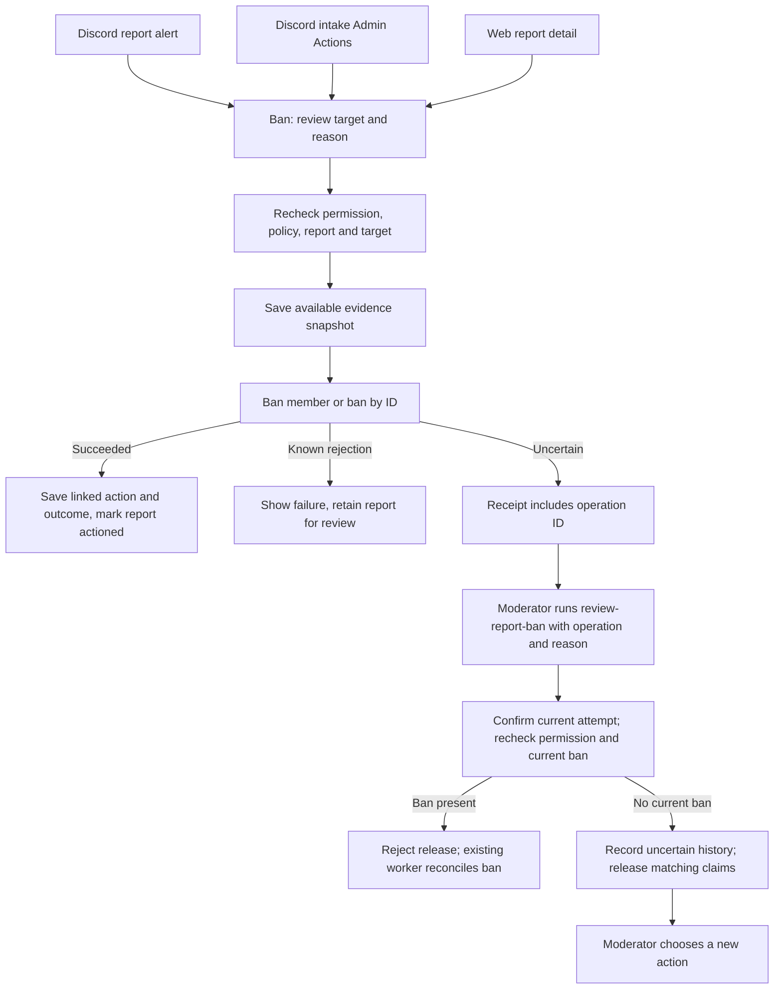

# Reliable verification and direct report bans

## Outcome and confirmed scope

Fix duplicate verification prompts and stale member-departure controls. Let moderators ban directly from a submitted report in both the Discord intake-thread menu and the web report detail page, without first opening a case. Preserve the same available evidence and moderation audit information. One operator command lets a moderator review an uncertain ban with no current ban and release its claims. It never performs enforcement.

The user selected both Discord and web. The existing Discord report-alert Ban action remains part of the same workflow. All four tasks are implemented locally on the shared feature branch. Internal branch review is complete. Newly arrived external review feedback is being addressed in the same PR; PR completion remains pending. No merge, deployment, historical repair, or live Discord edit has been performed by this work.

## Moderator experience

A submitted report with a confirmed target offers Ban. The moderator reviews the target's readable identity and immutable ID, enters a reason under the existing server policy, and confirms the action. The bot rechecks the moderator's Ban Members permission, server policy, report state, and target at execution time.

The web page reports Queued while the bot is processing, then shows the actual outcome. A failed ban leaves the report available for review. A successful ban marks the report actioned and removes pending review attention. If Discord confirms the ban but later updates fail, show "Banned. Report updates are still pending." Keep the report unavailable for a second ban and reconcile audit/report updates without repeating enforcement. If the subject already left, the same confirmation bans by ID. If a case already exists, normal case resolution still runs.

Reuse the existing moderator session, reason modal, confirmation helper, and queue receipts. Reference-journey research is unnecessary for this settled flow.

## Verification behavior

- Creation and repair of the same case coordinate before creating a thread or posting its initial prompt. Repeated calls reuse the prompt. Legacy moderator-only report review repair never adds the subject or sends a verification prompt. A concurrent promotion waits, then rereads persisted state and creates or repairs the user-visible verification thread.
- Persist the prompt message identity. Repair fetches it directly and reconciles a missing marker before sending. A timeout, permission error, or failed history read leaves repair incomplete without sending a replacement. A missing-message response or successful history scan must establish absence first. Match initial prompts by bot identity and the exact case-bound action ID, not any bot mention of the subject. Preserve recovery after partial setup failure.
- Evidence and setup writes update only the fields they own, without overwriting newer departure, reminder, resolution, quarantine, or action metadata.
- Departure keeps the case pending for moderator judgment, displays Member Left Server, and offers the existing Ban by ID and Close No Action controls. It stops user-facing reminders. A confirmed external ban resolves the case normally.
- Late setup/evidence completion rereads current state before updating moderator notifications or queue messages.
- The investigated reminder example was banned before its second reminder became due. Retain the existing repeat interval and moderator review window.

## Evidence and audit contract

Capture the same available profile assets, optional existing image description, detection history, and retained recent-message context used by case evidence capture. Retain report text, attachments, reporter identity, target confirmation, and source references. Record actor, reason, action time, source, detection/report links, user snapshot, and actual moderation outcome.

Extract one evidence collector for case setup and direct report bans. Store the report-ban snapshot on its linked detection record using an atomic metadata patch. Existing report evidence stays in its current records. Case IDs remain nullable when no case was opened; creating a fake pending case, case role, or verification thread would defeat the requested shortcut.

Evidence persistence must succeed before enforcement. Optional data that cannot be fetched is recorded as unavailable; do not invent history, require a new model analysis, or prevent a ban solely because an optional enrichment is absent. Retained context remains subject to existing retention. A departed member's missing live profile fields cannot be reconstructed reliably.

Both surfaces use the existing observed-ban service and its action claim, rather than duplicating enforcement logic. A queued request carries the report ID and expected detection/target. Its request ID identifies the operation. The database mints a fresh internal attempt token for each safe retry; preparation and claims require the current token and a successful compare-and-swap transition. Neither entry point supplies that token. At worker execution, atomically claim that exact submitted report before collecting evidence. All competing close/open-case/target-change paths must honor the claim and return a busy result. A report closed before the claim cancels the queued ban; a close after the claim is rejected until completion or reconciliation. Revalidate the claim immediately before enforcement. Repeated clicks execute one destructive operation.

Use a structured outcome with `banned`, `already_handled`, `banned_updates_pending`, and `ban_outcome_unknown` variants. Pre-enforcement failures report a failed request and release the preparation claim. After confirmed enforcement, retain the operation identity and finish only idempotent audit/report cleanup. An interrupted send with no confirmed outcome is reconciliation-required. If Discord confirms the ban, finish cleanup; otherwise show "Ban outcome needs review." Never automatically resend an uncertain enforcement action or turn an audit failure into a generic retryable ban failure.

The existing bot action worker runs a bounded reconciliation sweep every poll, including on startup, for report-ban operations with unfinished phases or pending-update receipts, regardless of request status. It acquires a database lease for each operation before cleanup. Failed cleanup retries after one minute, five minutes, fifteen minutes, then hourly; the receipt stays visible with the last error until recovered. A restart must resume this work. No external monitoring service or new automation is needed.

## Operator recovery after an uncertain ban

[AGENT] A moderator can run `/review-report-ban operation:<operation-id> reason:<review reason>` in the affected Discord server. The Discord queue receipt includes the operation ID; an unknown web receipt includes the ID and command hint. The command shows the target and reason for confirmation and captures the current attempt/version internally. It rechecks the actor's Ban Members permission and fetches the current Discord ban at confirmation. A present ban, ambiguous lookup failure, or changed operation rejects the release.

An explicit Unknown Ban response permits the disposition **no current ban, historical outcome uncertain**. This records the reviewer, reason, time, original attempt, result and operation metadata in durable request history, stops reconciliation and atomically releases only matching report/detection/case claims. It neither bans nor unbans anyone and does not change member status. Absence is not evidence that no historical ban occurred. The reviewed receipt permits a later explicit moderation decision; a fresh attempt receives fresh ownership and cannot inherit the earlier review.

Successful observed-ban completion analytics are claimed once per operation after durable completion, including recovery. Capture is best effort: a crash after the claim can lose the event, and analytics failure cannot change moderation success. This does not promise transactional delivery to the analytics provider.

## Delivery recommendation and limits

The user requested one PR with subagent implementation. Sequence verification lifecycle fixes before report-ban entry points and shared evidence capture, keeping all task commits in the same PR. Existing JSON metadata and request types should be sufficient; no schema migration is proposed. If implementation proves otherwise, revise this plan before introducing one.

Single-instance coordination addresses the reproduced overlap. Discord send followed by a process crash remains an uncertain-send boundary; recovery must reconcile persisted identity and thread history. Do not claim universal exactly-once Discord delivery.

Production repair is separate. After the code fix, propose an exact-case repair preview using current membership and saved outcome history. It must not ban, automatically close the case, or delete either duplicate message without authorization. Merging main automatically deploys the bot, so merge/deployment requires its own explicit decision.

## Decision still needed

The user confirmed both surfaces and selected one PR with subagent implementation. Implementation is authorized within the stated worktree and release boundaries.

## Engineering references

The investigation and local reproductions are in the calling chat's artifact directory. Primary files are `ThreadManager.ts`, `SecurityActionService.ts`, `VerificationEventRepository.ts`, `CaseReviewReminderService.ts`, `ReportInteractionHandler.ts`, `InteractionHandler.ts`, `ReportReviewService.ts`, `ModerationActionRequestService.ts`, and the web report adapters/actions/components. The implementation plan lists exact paths and tests.
