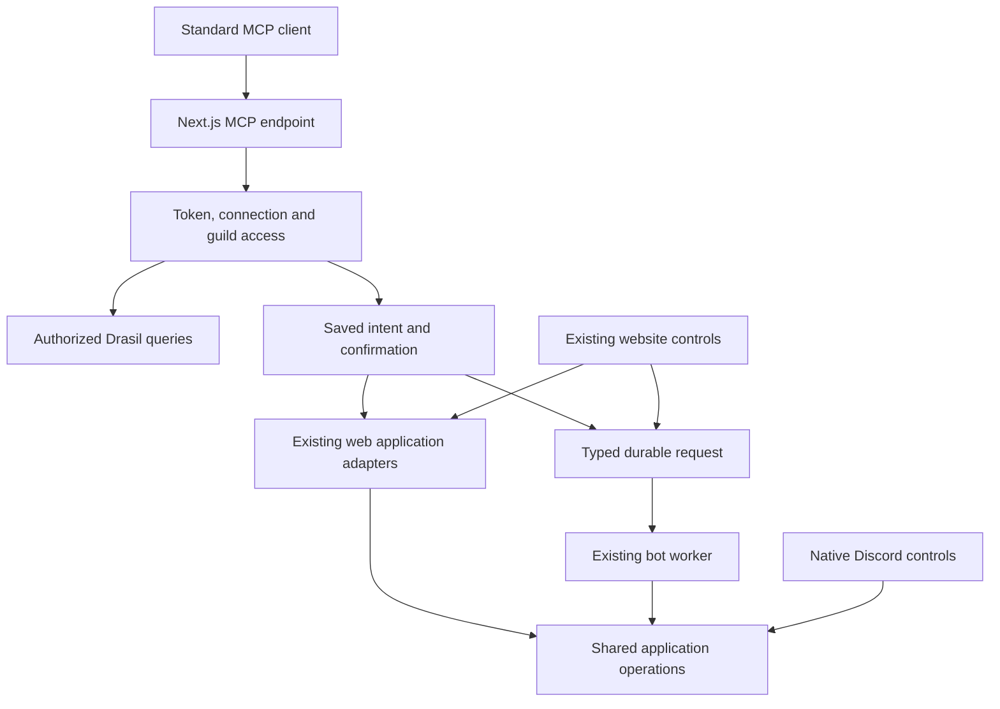

# Drasil MCP

Date: 2026-10-20

Status: Approved for implementation planning on 2026-10-20. Product implementation awaits plan review.

Related work: #89, merged PRs #255 and #257, [action boundary](../../dev/action-boundary.md), [caller inventory](../../dev/action-boundary-inventory.md).

## Purpose and scope

Let any moderator in a Drasil server connect a standard MCP client and use their existing authorized Drasil workflows. Launch with the full human action set in the shared application boundary, including enforcement and configuration, plus the reads needed to use those actions. Support ChatGPT, Codex and Claude through the same remote endpoint.

One connection covers selected servers or all eligible servers. Each operation still checks the moderator's current Discord authority, Drasil policy, target and state. Connecting a client grants no new Discord privileges.

Keep Drasil focused on its moderation workflows. General Discord administration, arbitrary role assignment, nickname changes and general message composition are outside this release. Existing case-role changes, quarantine, report panels and case-bound message cleanup remain in scope because they already belong to Drasil.

This design adds MCP, its delegated authentication and missing delivery/read contracts. It does not rebuild the application boundary, migrate the whole website to a new auth system, or queue every existing mutation. Deliver the initial MCP implementation as one merge-ready PR; implementation tasks can proceed by family inside that PR.

## Existing foundation

PRs #255 and #257 made `@drasil/application` the shared owner of action authority, policy, confirmation requirements, binding checks and workflow orchestration. The merged tree at `6edfbd3` is the baseline.

- `createBotApplication` composes shared actions with bot services. Native Discord callers can execute them directly.
- `createWebApplication` supports direct setup updates, report review and attention actions through web adapters.
- `submitQueuedAction` encodes a typed command and inserts a durable request. Forty kinds currently ship.
- `prepareQueuedRequest` and the exhaustive worker registry bind request-specific dependencies. The worker owns claims, leases, completion and recovery.
- Existing queue coverage excludes some native commands and semantic variants. This is a delivery gap, not missing business logic.
- Existing dashboard access requires Manage Server. Reusing that entry gate would exclude eligible moderators and configured staff roles.
- `ConfirmationBinding` currently binds actor, guild, action and target. MCP needs an additional persisted intent record that binds every option and the client connection.

The [caller inventory](../../dev/action-boundary-inventory.md) remains the detailed baseline for permissions and behavior. The coverage table below states which parts MCP must make available.

## Architecture and ownership

| Owner                                 | Responsibility                                                                                              |
| ------------------------------------- | ----------------------------------------------------------------------------------------------------------- |
| MCP adapter in `apps/web`             | Protocol, tool discovery, strict public schemas, authenticated context, elicitation and result presentation |
| OAuth issuer in `apps/web`            | Discord identity login, client authorization, tokens, refresh and revocation through maintained packages    |
| Connection access service             | Selected/all-eligible guild policy, granted capability scopes, revocation and fresh eligibility             |
| Shared application query policies     | Authorization and guild/resource binding for reads, independent of dashboard presentation                   |
| Intent store and confirmation adapter | Exact saved action, expiry, approval method and atomic binding to one execution                             |
| `@drasil/application`                 | Existing command validation, authority, policy, state checks and orchestration                              |
| Web and bot adapters                  | Existing database and Discord effects; new delivery adapters where required                                 |
| Durable worker                        | Existing claim, fencing, heartbeat, completion and recovery behavior                                        |

The shared library stays directly callable. Delivery is a composition decision. MCP calls an existing web-supported operation directly; work requiring bot services goes through the queue. Native Discord operations keep their existing direct path. Do not add a bot HTTP listener or authenticated bot RPC.

## Protocol and package choices

Use the maintained `mcp-handler` Next.js adapter with the official `@modelcontextprotocol/server` SDK. Use `better-auth` with its OAuth Provider, JWT and CIMD plugins for the authorization server. The MCP adapter owns protected-resource metadata and bearer challenges; avoid two packages registering competing metadata or protocol handlers.

Research on 2026-10-20 found `mcp-handler` 2.3.0, SDK server 2.3.1 and OAuth Provider 1.7.12. These identify the researched release lines, not permission to float dependencies. Resolve compatible versions and commit the lockfile during implementation.

Expose one HTTPS Streamable HTTP endpoint at `/api/mcp` in the existing Next.js app, using its Node runtime. Use the adapter's supported 2026 protocol and 2025 Streamable HTTP compatibility path. Do not require Redis, a persistent MCP process, proprietary client extensions or the old 2024 HTTP+SSE transport. Keep all application state in Postgres rather than process memory or MCP session affinity.

Current SDK schemas use Standard Schema with JSON Schema support. The application currently uses Zod 3. Keep those canonical validators. A small MCP schema adapter must publish their public JSON Schema and run the canonical parser; test advertised and accepted input together. Any Zod 4 dependency required by the transport stays at the web boundary. A whole-repository schema migration is outside scope.

Use standard tools and structured results. Optional client-specific approval metadata can improve a host's prompt, but cannot be required for correctness. Detect elicitation support using the negotiated protocol and capabilities; 2026 per-request capabilities and continuation behavior differ from 2025 elicitation. Delegate those differences to the SDK and adapter rather than assuming a long-lived server-to-client request.

## Identity, consent and multiple servers

The issuer uses Discord sign-in and maps the verified Discord subject to the actor's immutable Discord user ID. Do not link identities by display name or email. MCP uses its own issuer session and namespaced persistence; existing website cookies and callback behavior remain intact. A user may need to sign in once when connecting MCP even if they already have a website session.

The issuer must provide OAuth authorization-code flow with S256 PKCE, authorization-server discovery, audience/resource-bound access tokens, refresh-token rotation and revocation. Set access-token lifetime to 15 minutes and refresh-token lifetime to 30 days. Enable CIMD with the package's Node transport that pins validated public DNS addresses and rejects redirects. Enable rate-limited public DCR for clients that still require it, with the package's native/web redirect rules. Do not enable machine credentials, password grants or automatic consent bypass for newly discovered clients.

Use the canonical MCP endpoint URL as the resource audience and explicitly configure its allowed scopes in the issuer. Validate signature, issuer, audience, expiry and client binding, then load the active connection from storage on every call. A locally valid JWT must not bypass a revoked connection. Discord credentials never become MCP credentials, enter tool arguments/results, or get passed to the MCP client. Use bot-authenticated Discord REST membership/role checks after login rather than depending on a stale Discord OAuth guild list.

At connection consent, show the client identity, requested capabilities and server selection. Treat client names and metadata as untrusted display text. Save a connection grant bound to the user, OAuth client and token authorization, with one of these guild policies:

- `selected`: a fixed set of explicitly selected guild IDs. Newly eligible guilds require editing consent.
- `all_eligible`: all guilds where Drasil is active and the user currently qualifies, including future eligible guilds. Say this explicitly at consent.

Eligibility includes the owner, Administrator, Manage Server, Moderate Members, Ban Members, Kick Members and configured Drasil staff roles accepted by existing human workflows. Eligibility allows connecting to the guild; it does not grant all actions or all reads. A staff-role-only moderator may review reports without gaining case-opening or enforcement authority.

Define scopes `drasil:read`, `drasil:moderate` and `drasil:configure`, with `offline_access` for long-lived connections. The full-action connection requests all three Drasil scopes; users can grant less. Scopes are a ceiling. The effective grant is the intersection of scope, connection guild policy, active guild membership, current Discord authority and the operation's existing Drasil policy. List per-guild capabilities for guidance, and recheck authority when executing.

Discovery may use a bounded eligibility cache, but each resource read and mutation admission must refresh the relevant actor/guild facts. Fail closed when those facts cannot be refreshed. Removing a selected guild or revoking a connection invalidates pending confirmations and prevents new work under that grant.

Check the connection again before an MCP-origin queued request starts new effects, alongside the worker's existing fresh operation authority checks. A request waiting in the queue after revocation ends with a denied receipt. Once effects have begun, revocation cannot undo them; finish necessary bookkeeping and reconciliation without authorizing new enforcement. A transport disconnect alone does not cancel accepted work. Connection revocation and token expiry are distinct: an accepted request can finish after its short-lived access token expires if its connection remains active.

## Read authorization

Add reusable query policies beside the action policies. Web and MCP adapters can share them without widening the existing dashboard entry gate. Route handlers must not read arbitrary repository rows before authorizing and applying guild bindings.

| Read                                                 | Access rule and limits                                                                                                                                              |
| ---------------------------------------------------- | ------------------------------------------------------------------------------------------------------------------------------------------------------------------- |
| Eligible guilds and own capabilities                 | Authenticated connection, guild policy and current eligibility; expose only eligible guilds                                                                         |
| Cases and case history                               | Owner, Administrator, Manage Server, Moderate Members, or configured case responder role; guild-bound staff case records                                            |
| Detections, reports and intake review                | Existing report staff predicate, including configured staff roles; reporter-only details stay limited to their own report/intake under the existing ownership rules |
| Minimal member context                               | Current guild membership plus authority for the associated Drasil workflow; return only identity and moderation facts needed for that workflow                      |
| Attention                                            | Existing attention authority; item must belong to the selected guild                                                                                                |
| Setup/settings and operation diagnostics             | Existing family authority; redact secrets and infrastructure diagnostics; configuration writes still require configure scope                                        |
| Execution and confirmation status                    | Original actor and connection, currently authorized for the guild/resource; receipts cannot be used to enumerate other users' operations                            |
| Raw Discord messages, attachments and thread context | Relevant Drasil read authority plus both bot access and the actor's effective channel/thread visibility                                                             |

The case responder read rule is a new explicit policy. It does not change existing action permissions. Resolve configured report staff roles through the existing shared staff-role source instead of inventing a second role list.

Implement Discord visibility with effective role/member overwrites and private-thread membership. Do not substitute guild-level permissions, bot visibility, or possession of a message ID. Require View Channel and Read Message History where appropriate. Deny access when visibility cannot be established. Stored Drasil evidence remains subject to staff record policy; do not attach unrestricted raw message history to those records.

Provide bounded list/detail tools for cases, reports/intakes, detections, attention, relevant member context, setup and execution receipts. Each request chooses one allowed guild; cross-server work uses explicit calls. Default list size is 25 and maximum 100. Bind opaque pagination cursors to connection, guild, filters and ordering. Limit text/attachment metadata per response, mark truncation and provide authorized detail reads. External message text is data, never tool instructions. Do not fetch arbitrary caller-supplied URLs or expose signed provider credentials.

Global or null-guild records require an existing global-operator policy and are outside this guild-moderator release. Server selection never authorizes global watchlist administration.

## Tool contracts and full action coverage

Expose named Drasil workflow tools, with family grouping only where the choices form a clear bounded enum. Do not expose `execute_any_command`, arbitrary database mutations, raw queue metadata or a caller-selected system actor. Tool inputs may identify an allowed guild and resource, but trusted code constructs `ActionContext`, source `mcp`, request identity, semantic intent and connection provenance.

The implementation must produce an executable coverage manifest that maps every human command/variant and public method below to its public tool, authority policy, confirmation policy, delivery and result contract. Compare it with the canonical command schemas and caller inventory so a missing variant fails validation. Coverage includes actions that the connected moderator cannot personally execute; such actions remain denied by their existing authority rules.

| Family                      | Required human workflows                                                                                                                                                                                                                                                | MCP delivery                                                                         |
| --------------------------- | ----------------------------------------------------------------------------------------------------------------------------------------------------------------------------------------------------------------------------------------------------------------------- | ------------------------------------------------------------------------------------ |
| Native member moderation    | `ban_user`, `kick_user`, including selected-message context and current reason policy                                                                                                                                                                                   | Add typed bot delivery; native Discord stays direct                                  |
| Cases                       | `open_case_from_observed_detection`, `open_admin_case`, `manual_flag_user`, `verify_case_user`, `close_case_no_action`, `kick_case_user`, `ban_case_user`, `ban_case_user_by_id`, `repair_active_case`, `reopen_case`, `refresh_case_notification`, `sync_existing_ban` | Existing queue; add missing semantic variants                                        |
| Detection triage/accounting | `dismiss_observed_detection`, `mark_observed_detection_false_positive`, `undo_observed_detection_action`, `kick_observed_detection`, `ban_observed_detection` for observed/report subjects, `ignore_detection_accounting`, `restore_detection_accounting`               | Existing queue and recovery                                                          |
| Uncertain report bans       | `prepare_report_ban_review`, `review_uncertain_report_ban` with the existing opaque review reference                                                                                                                                                                    | Add typed bot delivery; never expose attempt/fencing tokens                          |
| Reports and intake          | `submit_user_report`, `submit_message_report`, `start_report_intake`, `close_report_intake`, `confirm_intake_candidate`, `reject_intake_candidates`                                                                                                                     | Existing queue plus missing message/candidate delivery                               |
| Report review               | Close with `mark_actioned`, `dismiss_no_action`, `mark_false_positive`; open a case; report ban through detection workflow                                                                                                                                              | Existing direct review adapter and queued case/ban handoff                           |
| Attention                   | `acknowledge`, `acknowledgeBatch`, with individual outcomes                                                                                                                                                                                                             | Existing direct web adapter                                                          |
| Moderator CAPTCHA           | `request_captcha_challenge`, `retry_captcha_challenge`, `bypass_captcha_challenge` with expected challenge/generation                                                                                                                                                   | Existing queue                                                                       |
| Quarantine                  | `preview_account_quarantine`, `quarantine_compromised_account`, preserving case and persisted preview binding                                                                                                                                                           | Existing queue and frozen preview protocol                                           |
| Case message cleanup        | `preview_case_message_deletion`, `execute_case_message_deletion`, `ban_case_user_with_message_cleanup`                                                                                                                                                                  | Existing queue and job/generation protocol                                           |
| Queue and guild operations  | `sync_moderation_queue`, `clear_moderation_queue`, `close_resolved_case_threads` with preview/execute modes, `audit_case_role_lockdown`, `apply_case_role_lockdown`, `intake_role_members` with preview/execute modes, `audit_integrity`                                | Existing queue plus missing audit/intent delivery                                    |
| Configuration               | `update_settings` for all 11 sections, `update_setup`, `update_heuristics`, `reset_heuristics`, `lockdown_allow_add`, `lockdown_allow_remove`, `disable_lockdown`                                                                                                       | Existing web adapter where available; add typed delivery for remaining bot workflows |
| Setup and report panels     | `complete_setup_verification` provision/verification-modal modes, `upsert_report_instructions` repair/repost, `clear_report_instructions`                                                                                                                               | Existing queue plus missing bot delivery                                             |

Preserve semantic variants rather than laundering MCP through dashboard authority. For example, native case opening requires Moderate Members while dashboard case opening requires Manage Server. Administrator repair differs from moderator repair, and guild-audit thread closure differs from administrator operation closure. Public workflow selection maps to these explicit variants; clients cannot supply arbitrary internal provenance or choose a weaker policy label.

Settings coverage includes all 73 currently mutable fields represented by the canonical setup schemas. Use structured patches with strict section-specific schemas and show a before/after diff for confirmation. Do not offer arbitrary JSON configuration replacement.

Discord-specific transport details are resolved by the adapter. Intake prompt tokens, interaction context and cleanup job creation are not fabricated by the client. Return a connection-bound opaque reference for an authorized intake prompt or preview, resolve its trusted fields server-side, then build the canonical command. The moderator's actual choice, resource IDs, reason and supported options remain explicit. Setup verification-modal mode describes the existing verification workflow; MCP presents its fields natively and preserves its checks without requiring a Discord modal interaction.

Mutation requests carry a caller-generated `idempotencyKey`, scoped by authenticated connection and actor. The key is correlation, never authorization. Store its canonical intent binding and return the original intent/receipt on an identical retry; reject reuse with changed arguments. Do not rely on JSON-RPC request IDs for durable deduplication. Separate intentional attempts use separate keys, while existing domain-level deduplication and protected queue receipts still apply.

Exclude `apply_captcha_pass`, `notify_captcha_attention`, internal report-ban reconciliation, automatic detection and lifecycle bookkeeping from public tools. A challenged member completes CAPTCHA through its existing browser protocol, not a tool that marks a challenge passed. Reading status does not reveal challenge secrets.

## Confirmation and execution

Use one policy vocabulary across interfaces while retaining their reasonable native flows. Existing application confirmation requirements are the minimum. Extract policy decisions when necessary, rather than copying a command list into the MCP adapter. Do not require an extra modal for reads, audits, previews or ordinary attention acknowledgement. MCP configuration writes additionally show and confirm the exact settings diff. Existing website and Discord controls retain their current interaction behavior.

When an operation needs confirmation, admission validates the command and current authority, resolves its references and saves an immutable intent. The record includes:

- Random opaque `confirmationId`, actor, guild, OAuth client and connection grant/version.
- Canonical command and semantic variant, all normalized options and reason, plus a digest/version of the canonical representation.
- Bound case/report/detection/intake/operation identity and any preview/job/generation reference.
- The exact human-readable summary, creation/expiry timestamps and confirmation method.
- State and the single execution/queue receipt linked when consumed.

Pending intents expire after ten minutes or the underlying preview's expiry, whichever comes first. Bound state changes or material policy/option changes require a new preview and intent. Creating an intent performs no requested enforcement or configuration write. Necessary preview work can run as its own explicitly read-only or preview operation.

Use these confirmation paths in order of client capability:

1. Native MCP form elicitation displays the saved summary and requests an explicit accept/decline. Bind the continuation to the saved intent and authenticated connection. Decline/cancel cannot dispatch work.
2. Without elicitation, return `confirmation_required`, the saved summary, expiry and `confirmationId`. The client asks the user to approve that exact action, then calls `confirm_action` with only the ID. There is no `approved: true` flag or editable command payload. `cancel_action` can discard a pending intent.
3. A user can choose an authenticated website or Discord confirmation for the same intent. The approving Discord identity must match the originating actor. Neither path bypasses current connection, guild or action authority. Do not send unsolicited Discord messages just because a preview was created.

The server can verify identity, exact intent, expiry, binding and one execution authorization. MCP cannot universally prove a human saw a dialog. Elicitation responses, chat confirmation and host tool-approval prompts rely on the client's enforcement of its user-interaction contract; some hosts support auto-approval. A `confirmationId` is not cryptographic evidence of human presence. Keep this trust model explicit, record the approval method, and never label a bare ID round trip as verified human approval. Optional host-specific interaction metadata can strengthen the host behavior without becoming a protocol dependency.

Do not credit a host's approval of the initial tool call as approval of a later generated summary. The saved-intent step still occurs before dispatch. Headless clients may use read/preview tools, but must not silently claim interactive approval; deployments requiring independently witnessed approval can choose the Discord/site path.

Atomically change a pending intent to one execution binding. For queued work, consume confirmation and insert/link the typed queue request in the same database transaction. Concurrent confirmations return the same receipt. A retry with different arguments or another actor, client, connection or guild fails. A terminal denial consumes that approval; a changed request requires a new one. Retrying receipt delivery does not reauthorize execution.

For direct web-supported actions, record the execution before invoking the existing adapter and preserve its result. This receipt is an execution record, not a background job. If the process dies after effects may have begun, report an uncertain outcome and reconcile through the domain's existing state/idempotency rules; never blindly run a non-idempotent action again. Do not promise exactly-once external Discord effects.

At execution the runtime issues request-bound evidence through the existing `ConfirmationPort`, using the saved command. Preserve cleanup's frozen scope/generation, quarantine fingerprints, CAPTCHA challenge generations, operation options and uncertain report-ban review references. Generic confirmation does not replace those protocols or weaken their state checks.

## Queue expansion and outcomes

Extend canonical queued schemas, storage codecs, database discriminants where needed, receipt mapping and the single worker registry together. Keep immutable actor/guild/target/intent bindings. Do not enqueue an untyped command blob or make the worker call an MCP tool.

Persist MCP connection and confirmation provenance as trusted request metadata with a validated runtime binding. A worker must not infer approval from arbitrary incoming metadata or a client-supplied `confirmed` field. Preserve the original actor and source for audit and recovery. Existing requests without MCP provenance keep their shipped behavior.

An existing domain deduplication key can resolve to work initiated through another interface or actor. Preserve that request's original provenance and protected state. Return an authorized resource-level already-handled/conflict outcome when appropriate; do not relabel it as the current actor's execution or expose another connection's private receipt. A matching idempotency key alone never grants receipt access.

New native ban/kick delivery needs an explicit retry/reconciliation policy before enabling its tools. A timeout after a Discord request is an uncertain external effect, not proof of failure. Reuse the domain state checks and existing fencing infrastructure; never make an automatic retry repeat potentially committed enforcement. Existing report-ban recovery remains enforcement-free after commitment and retains protected receipts.

MCP waits up to five seconds within the hosting request budget, then returns a durable receipt if work is still pending. The current worker polls roughly every five seconds, so a queued response is normal. Provide `get_action_status` for authorized polling with retry guidance. Do not require MCP Tasks support or keep an HTTP request open until bot completion.

Public results distinguish `confirmation_required`, `queued`, `running`, `completed`, `denied`, `failed`, `partial` and `uncertain`. These are MCP presentation states over existing domain/receipt outcomes, not a replacement for stored worker statuses. Include execution/request ID, operation, guild, target binding, safe domain outcome and relevant links. Do not flatten `already_handled`, no-op, busy, partial queue cleanup or uncertain enforcement into a generic success boolean. A batch returns each item outcome.

Do not offer generic cancellation of accepted enforcement. `cancel_action` only discards a pending intent. Connection revocation prevents not-yet-started effects as described above; it cannot roll back a completed Discord action.

## Persistence, errors and operations

Add namespaced auth-provider tables and application-owned connection, intent and direct-execution records through reviewed Prisma migrations. Let the auth package own its token/client representation. Store application grant IDs in validated issuer claims or a server-side token authorization mapping; never accept a caller's connection ID as authority. Retain queue request IDs and immutable execution links for audit.

Pending intents are indexed by expiry and bounded per actor/connection. Expired entries become unusable even before cleanup runs. Retention of completed confirmation/execution summaries follows existing moderation audit policy; prune expired ephemeral data without deleting protected moderation outcomes. Database changes must be additive for rolling deployment, with worker support deployed before enabling submission of new command variants.

Return stable machine-readable errors with safe explanations. Distinguish authentication/consent failure, action denial, stale preview, missing resource, temporary Discord unavailability and an uncertain external outcome. Resource errors must not disclose whether an inaccessible cross-guild ID exists. Respect Discord rate limits; provide bounded backoff/poll guidance rather than an agent retry loop.

Rate-limit OAuth registration, metadata discovery, intent creation, reads and mutations per user/client/guild as appropriate. Logs and audit events include actor, guild, client, connection, command variant, confirmation method, request/execution ID and outcome. Exclude bearer/refresh tokens, Discord credentials, CAPTCHA secrets and private fencing tokens. Measure queue delay, confirmation expiry, authorization denials and partial/uncertain results.

## Alternatives considered

| Approach                                                             | Assessment                                                                                                                                                              |
| -------------------------------------------------------------------- | ----------------------------------------------------------------------------------------------------------------------------------------------------------------------- |
| Bot-hosted MCP or authenticated web-to-bot RPC                       | Adds a new bot network service and separate delivery/auth lifecycle. The chosen durable queue already provides the needed cross-runtime delivery.                       |
| Queue every operation, including existing direct web/Discord actions | Adds latency and work unrelated to crossing the bot boundary. Keep direct adapters and extend queue coverage only where required.                                       |
| Mandatory website approval for every mutation                        | Makes approval independently observable but breaks the requested native MCP experience. Offer it as an alternative while documenting client-mediated approval honestly. |
| Hand-written MCP or OAuth server                                     | Adds protocol and credential lifecycle work that maintained packages already own.                                                                                       |
| Generic Discord passthrough tools                                    | Expands the product beyond Drasil and can bypass case/containment state. Defer until concrete Drasil workflows justify them.                                            |

## Verification and launch criteria

The implementation plan must include the following evidence before calling the PR merge-ready:

- A coverage manifest for every human workflow and semantic variant in the table, with explicit system-only exclusions. Compare against canonical schemas, public application methods, current caller inventory and all setup fields.
- Direct/queued parity for authority, policy, semantic intent, confirmation and domain outcomes. Verify new queue codecs against real Postgres, including conflicting/concurrent submissions and immutable bindings.
- Real issuer/resource tests for discovery, PKCE, audience, scopes, refresh rotation, revocation, CIMD/DCR and safe redirects. Reject another client's tokens and tokens for another resource.
- Authorization tests for staff-role-only users, Ban/Kick-only users, departed moderators, changing roles, selected/all-eligible guilds, future eligible guilds and cross-guild resource IDs. Include channel overwrite and private-thread visibility tests.
- Confirmation tests for option/reason substitution, stale previews, expiry, decline/cancel, duplicate/concurrent approval, changed connection grants and replay. Verify one execution link without asserting exactly-once provider effects.
- Failure tests for revocation while queued, token expiry after admission, process failure during direct execution, worker restarts, ambiguous enforcement, partial cleanup and committed report-ban reconciliation.
- A real compatibility matrix for ChatGPT, Codex and Claude, recording exact client versions/surfaces, protocol negotiation, OAuth connection/refresh, read, confirmation, one controlled mutation and receipt polling. Exercise native elicitation and a standards-compliant client without it. Test 2025 Streamable HTTP fallback separately from the 2026 path.
- Package-level protocol tests with the official SDK client. Host-specific approval behavior must be observed in the real client; do not infer it from Responses API approval objects or a host's documentation alone.
- Existing bot/web regressions and required repository checks. Verify installed production package imports and the deployed Next.js route's request budget.

Launch behind an explicit MCP enablement flag, then test with a controlled Discord server and disposable targets. Run the complete flow through real clients before enabling public connections. Existing Discord/website moderation remains available while MCP is disabled. New OAuth consent and connection management are required website UI; a new general MCP moderation dashboard is outside scope.

## Sources and research boundaries

Repository evidence is the merged action-boundary implementation and its caller inventory, particularly `packages/application/src`, `src/application`, `apps/web/lib/application`, `apps/web/lib/session.ts` and the Discord auth routes. Package and protocol research was read on 2026-10-20:

- [MCP authorization, 2026-07-28](https://modelcontextprotocol.io/specification/2026-07-28/basic/authorization) and [elicitation](https://modelcontextprotocol.io/specification/2026-07-28/client/elicitation).
- [MCP handler](https://github.com/vercel/mcp-handler), including its version 2 transport and authorization documentation.
- [Official TypeScript SDK](https://github.com/modelcontextprotocol/typescript-sdk), including Standard Schema support.
- [Better Auth OAuth Provider](https://better-auth.com/docs/plugins/oauth-provider), [CIMD](https://better-auth.com/docs/plugins/cimd) and [MCP integration](https://better-auth.com/docs/plugins/mcp). Use one issuer composition; the separate MCP plugin is not needed when the handler owns the resource endpoint/metadata.
- [Claude Code MCP](https://code.claude.com/docs/en/mcp), [Codex app-server elicitation](https://learn.chatgpt.com/docs/app-server) and [OpenAI remote MCP API approval controls](https://developers.openai.com/api/docs/guides/tools-connectors-mcp).

These sources establish available protocol/package mechanisms. They do not establish that every ChatGPT or Claude product surface has identical elicitation behavior. The real-client launch matrix is required evidence, and the two-phase confirmation path avoids making a proprietary interaction feature mandatory.
