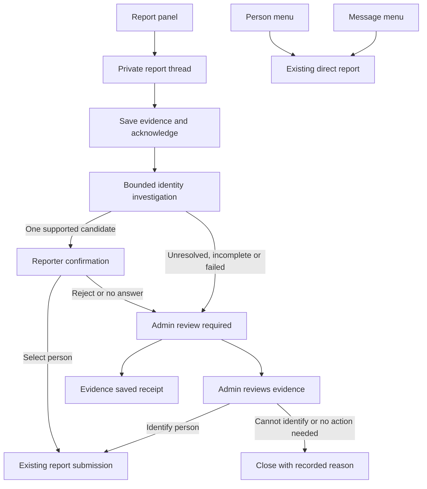
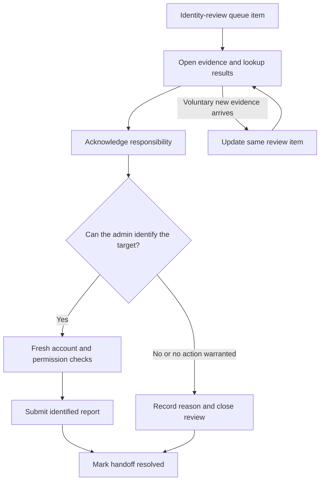

# A report assistant that resolves identities and brings admins in

## Review brief

Use a staged report assistant: preserve the evidence, extract person-specific clues, look up actual Discord accounts, and either request target confirmation or hand the situation to an admin. Drasil handles failed identification and directs it to an admin. Admins receive the evidence and the specific unresolved question.

This design covers the Discord report-panel intake, its identity resolver, the moderator handoff, and the worker and status reads that support them. Existing person-menu and message-menu reports retain their direct entry paths. Existing moderation policy and destructive-action confirmation remain separate.

**Confirmed:** the user selected the staged approach; server-visible names must be considered; unresolved reports must reach admins without another reporter action. **Approved on November 3, 2026:** the lookup strategy, limits, durable processing, and moderator experience below. **Unproven:** the exact reason the original account was not found. All nine implementation tasks and the full local acceptance gate are complete. Paid provider and live Discord validation remain pending. The [acceptance report](../reports/2026-11-03-staged-report-intake-acceptance.md) records exact source evidence and the known failed-submission recovery limitation; rollout is not approved by local test results.

The user approved this design and authorized implementation planning on November 3, 2026. The material tradeoffs are a bounded directory scan to support global display names, a small persistence change for restart recovery, and explicit admin workload when identification cannot finish. Engineering defaults are labeled below and can change during review.

## What the reporter and admin experience

### Reporter journey

A reporter opens a private thread and supplies an explanation, screenshot, or link. Drasil saves the evidence before starting analysis. A short acknowledgement says the evidence is being checked; it does not claim that a report was submitted or an admin was notified.

When exactly one sufficiently supported candidate exists, Drasil shows that person for confirmation. Multiple plausible identities go directly to admin review, where a maximum of five candidates is shown at once. Each identity has the effective server display name, account username, account display name when different, server nickname when different, and user ID. Repeated values are shown once. A short match reason identifies the actual field, such as a server nickname, without a numerical confidence badge. Duplicate display names remain distinguishable by username and ID.

The reporter can confirm the single candidate, choose Different person, or provide more evidence voluntarily. Existing multiple-choice controls outside this new intake flow remain unchanged. Confirmation submits through the existing moderation policy. Rejection triggers admin review immediately. Unresolved or conflicting identity, an analysis failure, incomplete lookup coverage, and an unanswered confirmation after the proposed ten-minute window also trigger admin review. None requires the reporter to find an ID or answer another question.

On a saved handoff, say: "Your evidence is saved for moderator review. You don't need to do anything else." Do not say an admin has been notified until notification delivery is recorded. The thread stays available for voluntary additions while the admin review is open. Closing the thread after the handoff does not cancel or erase the review request; say so next to that action.

### How a report reaches an outcome

### Admin journey

Reuse the moderation queue, its notification channel, and the intake thread. An identity-review item says why it needs attention, links to the original evidence, and shows the proposed candidates and matching fields. It distinguishes no supported match, multiple plausible people, incomplete search, rejected candidates, unreadable evidence, provider failure, and notification failure.

The admin can open the intake, acknowledge responsibility, select a currently validated candidate, supply a user ID for validation, or close the review with a reason. Acknowledgement records actor and time; it does not resolve the intake or clear the need for a decision. Selecting a target requires fresh server authorization and fresh account validation, then uses the existing report submission boundary. Confirmation by authorized staff does not require the reporter to return.

No role restriction, case opening, kick, or ban occurs merely because an identity-review item exists. Once an admin explicitly submits an identified target, existing configured report policy applies. A person who has left the server remains unresolved in this intake workflow; the admin can retain the evidence and use existing independently authorized moderation tools. This design does not invent cross-server account discovery or automatic enforcement against former members.

## Names are clues, IDs are identities

| Value                         | Source                               | Resolution rule                                                                                                         |
| ----------------------------- | ------------------------------------ | ----------------------------------------------------------------------------------------------------------------------- |
| Account ID                    | Discord user `id`                    | Validate it against Discord. An ID in a screenshot must belong to the reported subject, not a nearby bystander.         |
| Username                      | User `username`                      | Match the current account handle and retain the account ID.                                                             |
| Account display name          | User `global_name`                   | Search the current guild directory; names are not unique.                                                               |
| Server nickname               | Guild member `nick`                  | Search the current guild directory and the supported username/nickname endpoint.                                        |
| Effective server display name | `nickname ?? globalName ?? username` | Compare the derived value as well as its underlying fields. Do not treat it as an independent fourth name.              |
| Server title                  | Guild `name`                         | Context only. Exclude it from person lookup unless independent evidence clearly identifies a person with the same text. |

Normalize case, surrounding/repeated whitespace, and Unicode canonical form for matching. Preserve the original text for display and evidence. Do not strip meaningful punctuation or fold visually similar Unicode characters into a supposedly exact identity. Do not use avatar similarity as account proof.

The extraction schema records person candidates with their associated username, display-name clues, visible IDs, source evidence IDs, and uncertainty. A separate context field holds server titles and unrelated labels. Do not flatten every visible name into a global pool: two different people in one screenshot must not become one composite identity.

The model extracts and explains; code validates identifiers, performs lookups, checks state, and decides whether the required conditions for a candidate or a handoff exist. Extraction certainty, account-match evidence, membership freshness, and abuse assessment are distinct. Identity extraction does not issue an abuse verdict.

## When reporter confirmation is appropriate

A single candidate is sufficiently supported only when all of these conditions hold:

- The clue is associated with the reported subject. It is not a reporter, bystander, quoted third party, or server title.
- The source has an unambiguous typed identifier/name or a clear visual reading. A model confidence number alone does not meet this condition. The extraction contract carries an explicit clear, uncertain, or unreadable assessment for each clue.
- A validated same-server message author or account ID anchors the candidate, or an exact normalized username/name match identifies just one current member. Name-only uniqueness requires a completed, fresh directory scan.
- No relevant source contradicts that identity, and an uncached fetch confirms that the account is still a member and the relied-on current name still matches.

If OCR remains uncertain after the optional reread, send the candidate to the admin as a possibility, not to reporter confirmation as an established match. A lone search result from partial coverage does not qualify. Every accepted target still requires human confirmation; this rule does not authorize automatic report submission.

## Bounded investigation stages

1. **Snapshot the evidence revision.** Capture the exact eligible reporter messages and attachments for this run. The reporter's identity and the bot are excluded as target candidates. Staff notes can supply explicit moderator corrections, but are labeled separately and never impersonate reporter evidence.
2. **Resolve explicit anchors.** Validate reporter-provided IDs and same-server message links. A linked message's author is an anchor; quoted users and other participants are not automatically the target. Unsupported or inaccessible links become recorded lookup outcomes.
3. **Extract remaining clues.** Send only the selected evidence, labeled by source and author role. Use high image detail for identity text, within the existing image-count and byte caps. Record each included and excluded evidence ID. Excess evidence is retained for the admin, not silently marked analyzed.
4. **Resolve names against Discord.** Use the supported username/nickname search plus the current guild directory described below. Combine candidates by account ID while preserving every matching field and source. Conflicting explicit anchors trigger admin review instead of automatic selection.
5. **Reread once if useful.** If text is uncertain and there is no supported candidate, allow one targeted reread of the relevant original image. It may produce explicitly uncertain alternatives, not invented IDs or silently corrected usernames. No model-directed open-ended tool loop.
6. **Commit the outcome for this revision.** Present reporter confirmation only when the single-candidate rule below is satisfied. Otherwise persist admin review with the precise reason. A stale run cannot replace a newer decision, restore rejected controls, or move a submitted/closed report backwards.

Only exact normalized name matches enter the initial candidate shortlist. Approximate spellings may be shown to an admin as unresolved evidence; fuzzy matching and avatar matching are deferred until an evaluation set demonstrates value without misidentification.

### Complete enough to find display names

Discord's REST member search documents username and nickname prefixes, not arbitrary global display names. The ordinary discord.js cache is also not proof of a complete membership list. Therefore use one coalesced, on-demand guild-directory scan through the supported paginated member-list endpoint when name resolution is required. Store only ID and current name fields in an in-memory snapshot, not a permanent history of names.

Proposed engineering defaults: a five-minute snapshot lifetime; pages of at most 1,000 members; at most ten pages and fifteen seconds of directory work per run. Reuse a fresh completed snapshot across simultaneous reports in the same server. Apply observed member updates/removals and account username/global-display-name updates while a snapshot is held; invalidate affected snapshots if an update cannot be applied or after a gateway interruption. Revalidate shortlisted members with an uncached member fetch before presenting or accepting a selection.

Track pagination completion, age, interruption, and scan limit explicitly. A partial scan can yield evidence-backed positive candidates for admin review, but it cannot justify "no matching member" or a complete shortlist. Large guilds, missing privileged member access, rate limits, and expired scans go to admin review with partial coverage explained. These limits bound latency and data processing, at the cost of more admin review in large or inaccessible servers. A persistent member-name index is deferred.

## Durable state and concurrency

Keep the existing `report_intakes` and `report_intake_evidence` as the source of truth. Use the existing `needs_admin_confirmation` report status for identity review, with user-facing wording "Needs admin review". Retain `needs_reporter_confirmation`, `submitted`, and terminal statuses. Do not label an unidentified intake as a submitted account report.

Add the minimum queryable processing fields on the intake for a monotonic evidence revision, the completed analysis revision, due time, lease token/expiry, and attempt count. Put structured results, source coverage, safe failure categories, and handoff delivery/acknowledgement metadata in a versioned, validated metadata object. This is a proposed schema migration, required for restart-safe scheduling; it is not a migration of historical identity data.

Appending or revising reporter evidence and incrementing the revision must be one transaction. Duplicate Discord deliveries must not create another revision. Preserve prior evidence versions; mark edited or deleted sources so the active revision and admin presentation reflect them. Confirmation must check both the current prompt and evidence revision.

A small intake worker follows the repository's existing polling and lease conventions, but does not submit read-only investigation as an actor-authorized moderation command. The due row is the durable work request; an in-memory timer is only an optional wake-up optimization. Claim atomically, renew the lease during work, and commit only under the same lease token and evidence revision. Restarted workers reclaim expired leases. Use existing process lifecycle and dependency injection; add no queue framework.

Proposed defaults: a 15-second evidence debounce with a 30-second maximum batching delay, the existing 60-second minimum interval between investigations of one intake, a 45-second investigation deadline, at most two model requests per evidence revision, and one retry for transient transport/rate-limit failure when the budget permits. Save the absolute investigation deadline when the first worker claims the revision. The deadline continues across retry, lease expiry, and restart. Reserve each model attempt durably before dispatch; initial extraction, reread, retry, and a dispatched request whose outcome is unknown all consume the same two-attempt allowance. A recovered worker cannot reset either counter or deadline. A failure that exhausts this budget creates admin review rather than another reporter prompt. Schema/permission failures are not automatically retried. Build on existing conditional report writes and preserve their lock ordering.

A newer evidence revision supersedes unfinished work. An unconfirmed candidate prompt is retired before replacement. After admin handoff, a new voluntary evidence revision still runs the bounded analysis and refreshes the same admin item with updated candidates and coverage. The worker is therefore eligible in both collecting-evidence and admin-review states. It remains in admin review regardless of the new candidate count; it does not restart reporter confirmation, send another handoff receipt, ping the role again, or undo acknowledgement. After target submission, voluntary evidence remains attached for moderator review and does not automatically change the target.

## Handoff delivery is part of the outcome

Persist `needs_admin_confirmation`, its reason, and pending handoff metadata before attempting Discord delivery. Reuse the existing report-thread attention item, keyed by intake ID. Upgrade the generic evidence notice into an identity-review item rather than creating a second notification for the same situation. Acknowledging the existing queue item must preserve the review's unresolved state.

Track saved, delivery pending, delivered, acknowledged, and resolved separately. Store message/channel identifiers only after successful delivery. Updating evidence edits the same notification; do not ping the admin role again for an unchanged revision. If a delivery succeeded before a persistence failure, reconcile against the tracked intake marker and authored queue message before creating another. Discord cannot provide a transaction with Postgres, so temporary duplicate delivery remains a recovery risk to test and reconcile, not a claim of exactly-once messaging.

Delivery failures retain durable pending work. Proposed retry delays are 30 seconds, two minutes, and ten minutes; after that, periodic reconciliation continues without duplicate role pings while the intake remains open. Missing channel or permissions appears in existing operations diagnostics. If the configured queue destination is unusable, use the existing admin channel only after validating bot and admin access. If neither is usable, the review remains saved and visible through operator diagnostics; do not claim an admin was notified. Do not create new channels or change permissions automatically.

## Security and evidence boundaries

Every source message, image, extracted field, and retrieved message is untrusted evidence. None can add tools, change policy, authorize a moderation action, or override the server boundary. Restrict Discord attachment retrieval to validated source attachments; refresh expired attachment URLs through the original authorized message, not arbitrary URLs from model output. Record unavailable/deleted sources and hand them to admin review.

Use existing reporter/staff authorization for thread access and current moderator authorization for admin decisions. Candidate references are bound to intake, evidence revision, and prompt. Rendering escapes mentions and formatting; no model-controlled mentions or arbitrary role pings. Provider prompts and admin notifications exclude credentials. Apply the existing approved tracing and evidence-retention rules; the directory snapshot is ephemeral and does not expand historical profile retention.

## Approaches considered

| Approach                                                          | Tradeoff                                                                                                             | Decision                    |
| ----------------------------------------------------------------- | -------------------------------------------------------------------------------------------------------------------- | --------------------------- |
| Staged assistant with deterministic lookups and automatic handoff | Predictable bounds and testable outcomes; handles fewer novel investigations without an admin.                       | Selected by the user.       |
| Bounded model-directed investigative tool loop                    | Can adapt query order and follow uncertain clues; requires additional tool-policy, latency, and evaluation controls. | Not selected for this work. |

Keep the useful parts of the provisional patches: supported member search, exact filtering before the presentation limit, and regression coverage. Replace the provisional no-match request for more reporter input with the approved automatic admin handoff. The search-only patch is not sufficient display-name coverage on its own.

## Acceptance evidence required

| Scenario                                                                             | Required result                                                                                  |
| ------------------------------------------------------------------------------------ | ------------------------------------------------------------------------------------------------ |
| Username, global display name, server nickname, and effective server name all differ | Find the correct account through each applicable field and label the matching field accurately.  |
| Server title, reporter name, and mutual-user labels are visible                      | They do not become target clues without subject evidence.                                        |
| Exact person appears beyond the first five prefix matches                            | Correct candidate is retained; five is a presentation limit, not a search limit.                 |
| Duplicate names or conflicting ID/link clues                                         | No silent target selection; admin receives ambiguity and source evidence.                        |
| OCR typo, unreadable screenshot, or provider failure                                 | Bounded work, explicit uncertainty, automatic saved handoff; no required reporter follow-up.     |
| Missing member intent, scan cap, stale directory, or account departure               | Coverage/membership remains unknown or partial; admin review, not fabricated no-match certainty. |
| More evidence than the model budget, edited message, or deleted attachment           | Included/excluded source versions are recorded; no silent loss or false analyzed count.          |
| New evidence races with a running analysis or confirmation                           | Old results and controls cannot replace the newer revision or change a submitted target.         |
| Process restart, lease expiry, duplicate Discord event                               | Work resumes safely; no lost investigation or duplicate submission.                              |
| Admin delivery/receipt failure or acknowledgement                                    | Saved, delivered, acknowledged, and resolved remain distinct and recoverable.                    |
| Hostile evidence requests tools or moderation actions                                | The request remains evidence; no policy change or unauthorized action.                           |
| Clear candidate confirmed by reporter or admin                                       | Existing submission, policy, permissions, and action confirmations still apply.                  |

Use real repository/fake tests for state transitions and SDK-adapter contract tests for Discord responses. Add Postgres concurrency tests for revision/lease claims and conditional submission. Build a labeled synthetic screenshot set covering tiny text, multiple people, display-name differences, and misleading context. Run bounded provider evaluation separately from unit tests. Before rollout, prove one clean match and one forced unresolved handoff in a controlled server, including a restart and failed delivery recovery. Local green tests do not establish live acceptance.

## Scope, rollout, and deferred work

This is a report-intake design. Do not rebuild general moderation, add a general agent framework, change enforcement thresholds, or introduce cross-server searches. Preserve existing direct reports, user confirmation, and destructive-action approval rules. No new external service is required.

Implementation planning follows design approval. Split implementation at durable boundaries: evidence/state and worker, identity extraction/resolver, then admin handoff/presentation and end-to-end acceptance. Detailed task sizes and schema names belong in that plan. Deploy additive processing fields before code that depends on them; leave old in-flight intakes readable. Explicitly approved controlled recovery can enqueue older unresolved intakes, but do not bulk reprocess historical evidence or notify admins without rollout approval.

First enable the new flow in a controlled server. Observe completeness, wrong-candidate rate, handoff delivery/recovery, cost, and time to admin acknowledgement. Broader rollout, historical recovery, schema deployment, and production publication each retain the project's existing approval requirements. Rollback disables new processing while preserving evidence and pending admin review.

Deferred: persistent name history, fuzzy/visual identity matching, a general tool-using agent, cross-server identity search, and autonomous moderation.

## Design review

The independent builder check identified three consequential ambiguities. This revision resolves them as engineering proposals for approval: explicit criteria for the single candidate shown to a reporter; fresh analysis of voluntary evidence after handoff without returning responsibility to the reporter; and persisted request/deadline budgets that survive failures and restarts. It also removes the inconsistent earlier wording that offered ambiguous candidates to the reporter. A second independent builder check found no important questions left. The user subsequently approved the design and requested the implementation plan. Implementation has not started.

## Evidence appendix

- [Investigation, source findings, and sampled UX references](../research/2026-11-03-report-intake-investigation.md).
- [Existing reporting copy and conditional-write contracts](2026-10-12-report-copy-design.md).
- Discord [user fields](https://docs.discord.com/developers/resources/user#user-object), [guild member fields](https://docs.discord.com/developers/resources/guild#guild-member-object), [member search](https://docs.discord.com/developers/resources/guild#search-guild-members), and [paginated member listing](https://docs.discord.com/developers/resources/guild#list-guild-members).
- OpenAI [image detail guidance](https://developers.openai.com/api/docs/guides/images-vision). Detail and budget need validation against the configured model, not assumptions from a different model.
- Source baseline: `46b2b053060e19b35beccf23f7cf6756490cbe5f`.
- Provisional commits: `1a3791be25d826b7e9a691b5856d6243083f873c` and `e670d05e7677ea7816d7fd2c54db2127116ef259`, local only.
- Primary ownership: `ReportIntakeService`, `ReportIntakeAgentService`, `ReportCandidateService`, `GPTService`, `ReportIntakeRepository`, `ModerationQueueService`, `ReportInteractionHandler`, application report submission/authorization, intake web/contract status reads, and bot lifecycle wiring.
- The prior 87 focused tests and build checked the provisional patch. They do not validate this new design. The original incident's failed account match remains unresolved.
